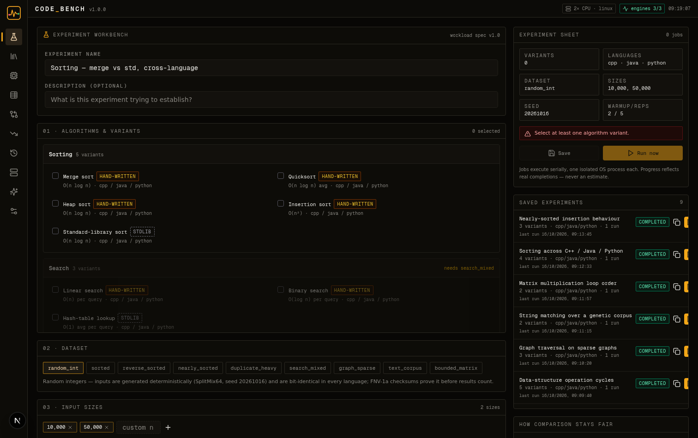
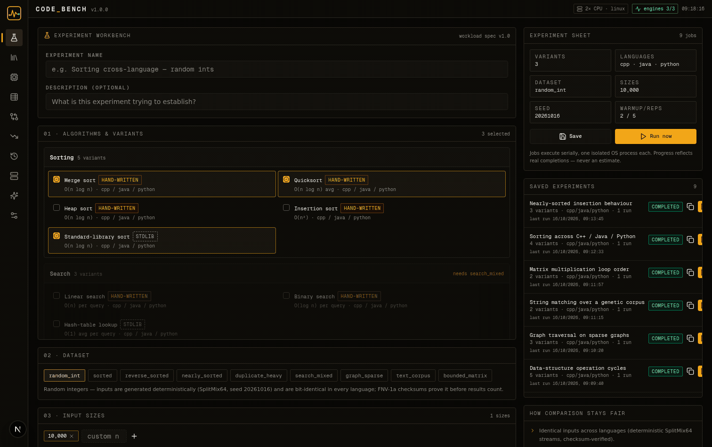
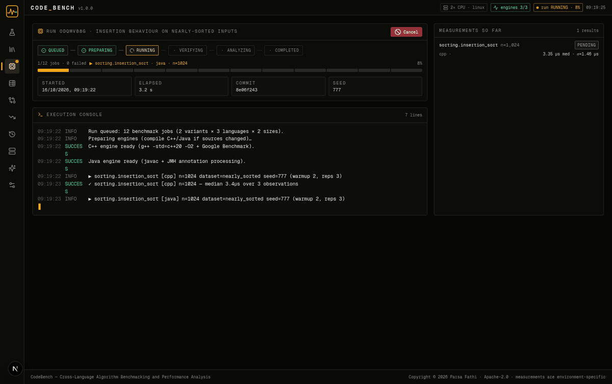
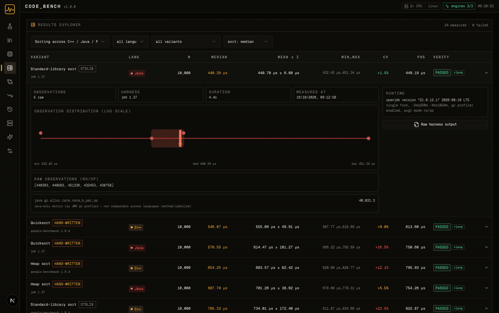

# CodeBench

**Cross-Language Algorithm Benchmarking and Performance Analysis Platform**

CodeBench executes the *same* algorithms in **C++**, **Java** and **Python** on **bit-identical inputs**, verifies that the outputs actually match, measures with each language's professional benchmark harness, and analyzes the raw observations — so cross-language comparisons rest on evidence instead of vibes.

```
Copyright © 2026 Parsa Fathi · Apache-2.0 · https://github.com/ParsaFathii
```

| | |
|---|---|
| **C++ engine** | g++ `-std=c++20 -O2` + [Google Benchmark](https://github.com/google/benchmark) 1.9.4 |
| **Java engine** | Temurin JDK 21 + [JMH](https://github.com/openjdk/jmh) 1.37 (single fork, gc profiler) |
| **Python engine** | CPython 3.12 + [pyperf](https://github.com/psf/pyperf) 2.10 (worker process) |
| **Web** | Next.js 16 · React 19 · TypeScript (single-route workbench) |
| **API** | REST under `/api/v1` |
| **Storage** | SQLite via Prisma (raw observations preserved per result) |
| **AI (optional)** | z-ai SDK / Ollama / disabled — evidence-grounded, never authoritative |



---

## Why CodeBench exists

Most "language X vs language Y" posts compare *labels*, not workloads: different input distributions, different warm-up discipline, hand-written code against tuned standard libraries, single wall-clock timings. CodeBench is built around the opposite discipline:

1. **Identical inputs.** Every dataset is generated from a shared `SplitMix64` PRNG, implemented bit-identically in all four codebases (TypeScript reference, C++, Java, Python). For the same `(dataset, size, seed)` every language provably consumes the same bytes — the FNV-1a 64 checksum of each input is compared before results count.
2. **Correctness before speed.** Each engine runs fixed verification cases plus one untimed operation on the real measured input *before any timing*. Checksums must match the TypeScript reference implementation *and* be equal across languages. A failed gate marks results `FAILED` — they are never ranked or averaged into comparisons.
3. **Real harnesses.** C++ is measured by Google Benchmark (repetitions, `DoNotOptimize` sinks), Java by JMH (warm-up iterations, forked JVM, blackhole consumers), Python by pyperf (worker-process isolation, calibrated loops). No single-call `time.time()` nonsense.
4. **Honest statistics.** Every repetition is a stored raw observation. Statistics (median, mean ± σ, percentiles, CV, 95 % t-interval) derive from those observations; outliers are flagged with the IQR rule and *retained*; instability is reported, never hidden.
5. **Labelled categories.** Hand-written and standard-library implementations are separate categories. `std::sort` vs `Arrays.sort` vs Timsort says as much about library engineering as about the language — so it is never silently mixed into an algorithm-only comparison.
6. **AI that knows its place.** The optional assistant receives only stored results and environment metadata, returns schema-validated structured output, and is rejected if it references variants or run ids that do not exist. It can never modify a measurement.

## What you can do with it

- Investigate **algorithm scaling** across languages with log–log runtime curves
- Compare **hand-written vs standard-library** implementations of the same algorithm
- Study **input-distribution sensitivity** (random / sorted / nearly-sorted / duplicate-heavy arrays, hit-miss query sets, sparse graphs…)
- **Reproduce** any run: seed + dataset + sizes + harness settings are recorded, and the raw harness output is preserved per result
- Detect **regressions** between two runs with practical-significance thresholds *and* run-to-run variation taken into account
- Export **reports** (JSON / CSV / Markdown) containing the full methodology and limitations
- Get an **evidence-grounded AI interpretation** of a run (or run fully without AI)

## The 10 views

| View | Purpose |
|---|---|
| **Workbench** | Configure experiments: algorithms, variants, dataset, input sizes, seed, warm-up, repetitions, timeout — validated before anything runs |
| **Catalog** | The 20 verified variants across 6 families with complexity, measured-op contracts and output contracts |
| **Runner** | Live execution: status pipeline, *real* per-job progress, streaming console, cancellation |
| **Results** | Every measurement with statistics; expand a row for the observation distribution, raw observation array, harness metadata and the preserved raw harness output |
| **Compare** | Scaling curves (log–log), head-to-head bars with 95 % CI whiskers, relative-performance table with verification badges |
| **Regression** | Baseline vs candidate with `REGRESSION / IMPROVEMENT / INCONCLUSIVE / NOT-COMPARABLE` verdicts and explicit noise reasoning |
| **History** | Run history with configuration, commit SHA, logs, report generation (md/json/csv) and download |
| **Environment** | Host metadata, engine availability, isolation & fairness policy — including what is *unavailable* rather than invented |
| **AI Insights** | Structured interpretation: findings, statistical evidence, hypotheses, recommended follow-ups, limitations, confidence |
| **Settings** | Measurement defaults, regression threshold, AI provider (z-ai / Ollama / disabled) |

### Live demos

**Configuring and launching an experiment** (Workbench):



**Real execution** — serial jobs, live console, genuine progress (Runner):



**From results to interpretation** (Results → Compare → Regression → History → AI):



## Algorithm catalog (v1.0)

| Family | Variants | Notes |
|---|---|---|
| Sorting | `merge_sort`, `quick_sort` (median-of-3, insertion cutoff), `heap_sort`, `insertion_sort` (n ≤ 4096), `std_sort` * | destructive sorts include the defensive input copy in the measured op — in every language |
| Search | `linear_search`, `binary_search`, `hash_lookup` * | mixed hit/miss query set; table construction is untimed setup |
| Data structures | `dynamic_array`, `queue_ops`, `priority_queue_ops` (hand-written heap), `pq_std` *, `hash_map_ops` * | priority queues use distinct shuffled keys so pop order is deterministic across implementations |
| Graphs | `bfs`, `dfs` (iterative), `dijkstra` | sparse digraphs (6 edges/node); Dijkstra encodes `(dist, node)` as `dist·2²⁰+node` so heap tie-breaking matches across languages |
| Strings | `naive_search`, `kmp` | fixed 32-char pattern over an A/C/G/T corpus |
| Matrix | `matmul_naive` (i-j-k), `matmul_ikj` | result buffer reset is part of the measured op everywhere |

\* = *standard-library category* — reflects library engineering as well as the language runtime; labelled separately in every view and report.

The correctness gate for all of this runs with:

```bash
bun scripts/verify-crosslang.ts
# ✓ 20/20 variants consistent across languages, 120 checksum comparisons
```

## Quick start

### 0) Prerequisites

- **bun** (or Node 20+) for the web app
- **g++** with C++20 support
- **Python 3.12+** with pip
- a **JDK 21** for javac/java (Temurin recommended)
- **cmake** (pip installable) to build Google Benchmark once

### 1) Toolchain (one-time)

The Java engine is self-contained (JMH jars are committed under `engines/java/lib/`). The C++ engine needs Google Benchmark built once:

```bash
pip install cmake pyperf

# Temurin JDK 21 (any JDK 21 works; remember where you put it)
curl -sL -o jdk21.tar.gz "https://api.adoptium.net/v3/binary/latest/21/ga/linux/x64/jdk/hotspot/normal/eclipse"
mkdir -p ~/.local/jdk21 && tar -xzf jdk21.tar.gz -C ~/.local/jdk21 --strip-components=1
export CODEBENCH_JDK_HOME="$HOME/.local/jdk21"   # or keep the default /home/z/.jdk

# Google Benchmark v1.9.4
git clone --depth 1 --branch v1.9.4 https://github.com/google/benchmark.git .cache/benchdeps/benchmark
cmake -S .cache/benchdeps/benchmark -B .cache/benchdeps/benchmark/build \
      -DCMAKE_BUILD_TYPE=Release -DBENCHMARK_ENABLE_TESTING=OFF -DBENCHMARK_ENABLE_GTEST_TESTS=OFF
cmake --build .cache/benchdeps/benchmark/build -j"$(nproc)"
```

### 2) Run

```bash
bun install
bun run db:push        # SQLite schema
bun run dev            # http://localhost:3000
```

Open the workbench, pick `merge_sort` + `std_sort`, select C++/Java/Python, add sizes, press **Run now** — and watch real measurements come in.

### 3) Verify everything (recommended)

```bash
bun scripts/verify-crosslang.ts   # cross-language + reference correctness gate
bash scripts/seed-one.sh 2        # optional: seed a demo experiment via the API
```

The Environment view shows live engine availability; the Runner view shows the execution console; the Results view exposes every raw observation.

## Documentation

**English**

- [Architecture](docs/ARCHITECTURE.md) — components, data flow, isolation policy
- [Benchmark methodology](docs/BENCHMARK_METHODOLOGY.md) — warm-up, repetitions, statistics, fairness, limitations
- [Algorithm catalog](docs/ALGORITHMS.md) — every variant, contract and language note
- [Results & statistics](docs/RESULTS_AND_STATISTICS.md) — how to read the numbers
- [API reference](docs/API.md) — every `/api/v1` endpoint with examples
- [Development guide](docs/DEVELOPMENT.md) — setup, commands, adding a variant
- [AI insights](docs/AI_INSIGHTS.md) — provider boundaries and validation

**فارسی**

- [معرفی CodeBench](docs/fa/README_FA.md) و [نصب](docs/fa/INSTALLATION_FA.md) · [راهنمای کاربری](docs/fa/USER_GUIDE_FA.md) · [معماری](docs/fa/ARCHITECTURE_FA.md) · [روش‌شناسی بنچمارک](docs/fa/BENCHMARK_METHODOLOGY_FA.md) · [الگوریتم‌ها](docs/fa/ALGORITHMS_FA.md) · [نتایج و آمار](docs/fa/RESULTS_AND_STATISTICS_FA.md) · [هوش مصنوعی](docs/fa/AI_INSIGHTS_FA.md) · [API](docs/fa/API_FA.md) · [توسعه](docs/fa/DEVELOPMENT_FA.md) · [انتشار](docs/fa/RELEASE_FA.md) · [حق نشر](docs/fa/COPYRIGHT_FA.md)

**Diagrams** — [system architecture](docs/assets/architecture.svg) · [execution & verification flow](docs/assets/execution-flow.svg) · [AI boundaries](docs/assets/ai-boundaries.svg)

## Measurement limitations (read before quoting numbers)

- Timings are **environment-specific**. This repository's canonical runs were measured on a shared 2-core virtualized machine *while the web app was running* — useful for methodology and for relative behaviour, not as publication-grade performance data.
- Warm-up eliminates the easy JIT/cache effects, not machine noise. Re-run before drawing conclusions; the CV column and stability badges tell you when variation is too high.
- Standard-library results include library engineering. Java hash workloads box `Long` keys; CPython `list.sort` is C-implemented Timsort. Both facts are features of the comparison, not bugs — but they must be *labelled*, which CodeBench does everywhere.
- A difference is only a regression when it exceeds the practical threshold **and** the pooled run-to-run variation. Everything else is explicitly `INCONCLUSIVE`.
- Shared CI runners can verify *correctness*, never produce canonical timings (the smoke workflow says so in its own output).

## Security & privacy

- The AI layer is optional (`disabled` turns it off completely) and, with Ollama, can run fully on your machine.
- The model receives benchmark results and environment summaries only — no source code, no filesystem contents, no credentials.
- Nothing in this repository requires secrets; the coordinator kills job process groups on timeout.

See [SECURITY.md](SECURITY.md) for reporting guidelines.

## Contributing

See [CONTRIBUTING.md](CONTRIBUTING.md) — the short version: every algorithm change must keep the cross-language verification gate green (`bun scripts/verify-crosslang.ts`), and measurement-semantics changes need a methodology-doc update in both English and Persian.

## Third-party components

Google Benchmark, JMH (+ jopt-simple, commons-math3), pyperf, Next.js, React, Prisma, Tailwind CSS, shadcn/ui, Recharts (unused at runtime — charts are hand-built SVG), Lucide icons, zod, TanStack Query, Zustand. Licenses and notices: [THIRD_PARTY_NOTICES.md](THIRD_PARTY_NOTICES.md).

## License

```
Copyright © 2026 Parsa Fathi

Licensed under the Apache License, Version 2.0 (the "License");
you may not use this file except in compliance with the License.
You may obtain a copy of the License at

    http://www.apache.org/licenses/LICENSE-2.0
```

See [LICENSE](LICENSE) for the full license text. Third-party components retain their original licenses and copyright notices.
